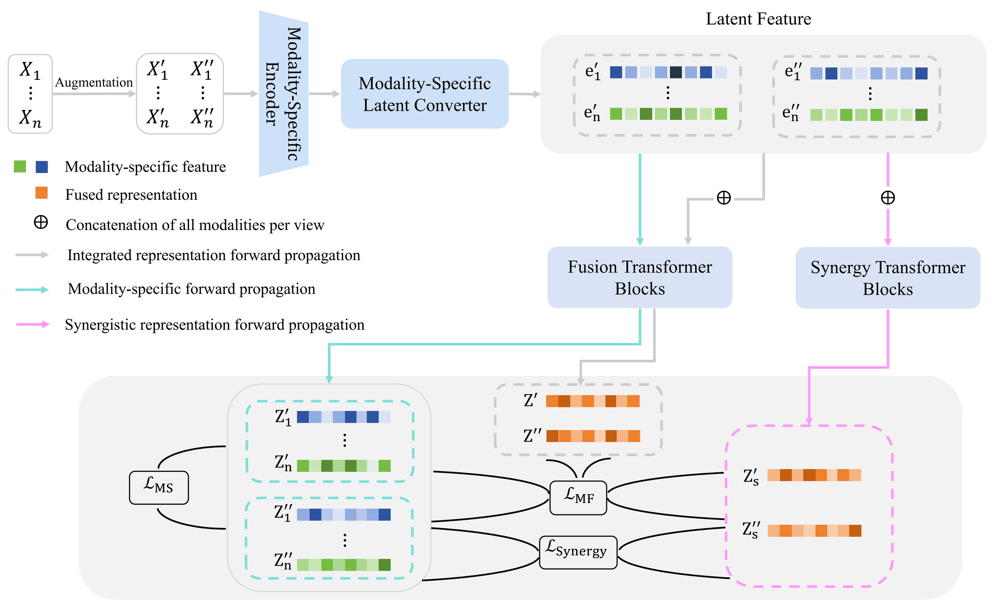

<h1 align="center">MIIB: Multimodal Information Interactions Bottleneck for Multimodal Self-Supervised Learning</h1>

<p align="center">
  Liangjian Wen, Jiangtao Zheng, Jiang Duan, Qun Dai, Yong Dai, Jianzhuang Liu, Jun Wang, Shu-Dong Huang, Xinwang Liu, Zenglin Xu, Zhao Kang
</p>

<p align="center">
  Accepted by IEEE Transactions on Pattern Analysis and Machine Intelligence (TPAMI), 2026.
</p>

**Paper:** [arXiv: 2611.07718](https://arxiv.org/pdf/2611.07718) · [DOI: 10.1109/TPAMI.2026.3751756](https://doi.org/10.1109/TPAMI.2026.3751756)

This repository contains the official PyTorch implementation of MIIB, a self-supervised learning framework that decomposes multimodal interactions into redundant, unique and synergistic information. It provides experiments on the synthetic **Trifeature** benchmark and on the **MultiBench** tasks **MOSI**, **MIMIC**, **UR-FUNNY**, **MUSTARD** and **Vision&Touch**, together with **MM-IMDb**.

## Overview

Multimodal self-supervised learning is challenged by heterogeneity, unequal informativeness and complex information interactions across modalities such as images, text, audio and tabular data. While contrastive methods effectively align shared semantics, they typically rely on strong multi-view redundancy assumptions, overlooking modality-specific and synergistic information.

MIIB is grounded in Partial Information Decomposition and explicitly decomposes multimodal interactions into three atoms: **redundancy** shared across modalities, **uniqueness** specific to a single modality, and **synergy** that only emerges through cross-modal interaction. It employs a **dual-path architecture** for modality-specific encoding and multimodal fusion, optimized with surrogate tractable entropy-based objectives that enforce minimal sufficient representations without requiring explicit mutual information estimation.

<p align="center">
  
</p>

The diagram shows the two interdependent processes that MIIB models. The **Fusion Transformer** produces individual-modality and fused representations that carry redundancy and uniqueness, while a separate **Synergy Transformer** operates on the concatenated multimodal features to capture interactions that neither modality carries alone. Each synergy representation is trained to predict the other view's fused representation, which can only be satisfied by information jointly carried across modalities — synergy is therefore learned rather than merely encouraged to differ from the unimodal streams.

### Differences against prior work

Compared with FactorCL and CoMM, MIIB differs in three respects:

1. Instead of regularizing a single fused space, it models multimodal learning as two interdependent processes — modality-specific encoding and fusion — and imposes a minimal-sufficiency bottleneck at both levels, so the two stages constrain each other.
2. It gives synergy a dedicated stream from a separate Synergy Transformer supervised by the fused cross-view representations, rather than only encouraging the synergy representation to differ from the unimodal streams.
3. The objective is reduced to a finite hyper-sphere entropy-and-alignment regularizer estimated by a score-based von Mises–Fisher estimator, avoiding the direct mutual information estimation that FactorCL and CoMM rely on.

### Experimental results

The tables below report the results published in the accepted paper.

#### Controlled information · Trifeature

Linear probing accuracy (in %) for redundancy (shape), uniqueness (texture) and synergy (color and texture). † denotes results reported by CoMM.

| Model | Redundancy ↑ | Uniqueness ↑ | Synergy ↑ |
| --- | ---: | ---: | ---: |
| Cross† | 100.0 | 11.6 | 50.0 |
| Cross+Self† | 99.7 | 86.9 | 50.0 |
| FactorCL† | 99.8 | 62.5 | 46.5 |
| CoMM | 99.9 ± 0.06 | 86.8 ± 2.99 | 71.4 ± 3.47 |
| **MIIB (ours)** | **99.9 ± 0.12** | **89.8 ± 3.23** | **79.1 ± 2.97** |

#### MultiBench · Linear probing

MSE (×10⁻⁴) for the regression task and top-1 accuracy (in %) for classification tasks. † denotes results reported by CoMM. The average is selected only from the classification tasks.

| Model | V&T EE ↓ | MIMIC ↑ | MOSI ↑ | UR-FUNNY ↑ | MUSTARD ↑ | Average ↑ |
| --- | ---: | ---: | ---: | ---: | ---: | ---: |
| Cross† | 33.09 ± 3.67 | 66.7 ± 0.1 | 47.8 ± 1.8 | 50.1 ± 1.9 | 53.5 ± 2.9 | 54.52 |
| Cross+Self† | 7.56 ± 0.31 | 65.49 ± 0.0 | 49.0 ± 1.1 | 59.9 ± 0.9 | 53.9 ± 4.0 | 57.07 |
| FactorCL† | 10.82 ± 0.56 | 67.3 ± 0.0 | 51.2 ± 1.6 | 60.5 ± 0.8 | 55.80 ± 0.9 | 58.7 |
| CoMM | 7.96 ± 2.13 | 66.4 ± 0.4 | 63.7 ± 2.5 | 63.3 ± 0.5 | 64.4 ± 1.1 | 64.45 |
| **MIIB (ours)** | **5.74 ± 0.69** | **68.1 ± 0.3** | **67.4 ± 1.8** | **65.4 ± 0.9** | **66.0 ± 2.0** | **66.73** |

#### MultiBench · Supervised fine-tuning

| Model | V&T EE ↓ | MIMIC ↑ | MOSI ↑ | UR-FUNNY ↑ | MUSTARD ↑ | Average ↑ |
| --- | ---: | ---: | ---: | ---: | ---: | ---: |
| CoMM | 1.61 ± 0.16 | 67.57 ± 0.65 | 71.84 ± 2.7 | 64.99 ± 0.96 | 68.25 ± 1.69 | 68.16 |
| **MIIB (fine-tuned)** | **1.47 ± 0.06** | **69.0 ± 0.57** | **73.24 ± 1.27** | **66.24 ± 0.18** | **69.73 ± 2.30** | **69.55** |

#### Trimodal benchmarks

Linear probing top-1 accuracy (in %) on Vision&Touch contact prediction and UR-FUNNY. † denotes results reported by CoMM.

| Model | # Mod. | V&T CP ↑ | UR-FUNNY ↑ |
| --- | ---: | ---: | ---: |
| Cross† | 2 | 86.3 ± 0.25 | 50.1 |
| Cross+Self† | 2 | 87.6 ± 0.26 | 59.9 |
| CoMM | 2 | 87.0 ± 1.58 | 63.3 ± 0.51 |
| **MIIB (ours)** | 2 | **88.4 ± 0.32** | **65.4 ± 0.90** |
| CMC† | 3 | 94.1 | 59.2 |
| CoMM | 3 | 94.1 ± 0.17 | 64.8 ± 1.13 |
| **MIIB (ours)** | 3 | **94.2 ± 0.11** | **66.2 ± 0.85** |

#### MM-IMDb

F1-score (weighted and macro, in %). △ indicates further training on unlabeled data. † denotes results reported by CoMM. MIIB and CoMM use the same pre-trained CLIP backbone.

*Linear probing:*

| Model | Modalities | Weighted F1 ↑ | Macro F1 ↑ |
| --- | :---: | ---: | ---: |
| SimCLR†△ | V | 40.35 ± 0.23 | 27.99 ± 0.33 |
| CLIP† | V | 51.5 | 40.8 |
| CLIP† | L | 51.0 | 43.0 |
| CLIP† | V+L | 58.9 | 50.9 |
| SLIP†△ | V+L | 56.54 ± 0.19 | 47.35 ± 0.27 |
| CLIP†△ | V+L | 54.49 ± 0.19 | 44.94 ± 0.30 |
| CoMM | V+L | 61.29 ± 0.73 | 53.79 ± 0.22 |
| **MIIB (ours)** | V+L | **62.80 ± 0.24** | **56.20 ± 0.16** |

*Supervised fine-tuning:*

| Model | Modalities | Weighted F1 ↑ | Macro F1 ↑ |
| --- | :---: | ---: | ---: |
| MFAS† | V+L | 62.50 | 55.6 |
| ReFNet† | V+L | - | 56.7 |
| CoMM | V+L | 63.92 ± 0.41 | 57.90 ± 0.39 |
| **MIIB (ours)** | V+L | **65.14 ± 0.11** | **59.32 ± 0.33** |

## 🗂 Repository Structure

```text
MIIB/
├── assets/          # architecture figure
├── configs/         # one complete YAML profile per paper experiment
├── dataset/         # benchmark data modules and portable catalog
├── evaluation/      # linear probes and metrics
├── losses/          # MIIB objective
├── models/          # MIIB encoder and modality backbones
├── pl_modules/      # Lightning training modules
├── run_scripts/     # training, testing and aggregation commands
├── run.py           # unified SSL training/test entry point
├── evaluate.py      # evaluate a saved SSL checkpoint
├── finetune.py      # downstream fine-tuning helper
├── compat.py        # checkpoint metadata translation for older releases
├── environment.yml
├── requirements.txt
└── README.md
```

Datasets, pretrained backbones, checkpoints and experiment outputs are intentionally excluded.

## 🚀 Quick Start

### 1. Installation

```bash
git clone <MIIB-repository-url>
cd MIIB
conda env create -f environment.yml
conda activate miib
```

The recorded stack is Python 3.8.18, PyTorch 2.1.0, torchvision 0.16.0, CUDA 11.8 and PyTorch Lightning 2.1.1.

### 2. Data and pretrained backbones

MIIB expects the preprocessed files used by the original experiments:

```text
<data-root>/
├── mosi/mosi_data.pkl
├── sarcasm/sarcasm.pkl
├── humor/humor.pkl
├── mimic/im.pk
├── visionandtouch/triangle_real_data/*.h5
├── trifeatures_3combi/{train,test}/*.png
└── mmimdb/{split.json,dataset/}
```

Set the external data root before training:

```bash
export MIIB_DATA_ROOT=/absolute/path/to/preprocessed-data
export TOKENIZERS_PARALLELISM=false
```

MM-IMDb additionally uses CLIP ViT-B/32 and `clip-ViT-B-32-multilingual-v1`. For offline execution:

```bash
export MIIB_VISION_CHECKPOINT=/absolute/path/to/vit_base_patch32_clip_224.openai/pytorch_model.bin
export MIIB_TEXT_MODEL=/absolute/path/to/clip-ViT-B-32-multilingual-v1
```

Relative entries in [`dataset/catalog.json`](dataset/catalog.json) resolve below `MIIB_DATA_ROOT`. Set `MIIB_CATALOG` to use another catalog. Data and model weights are not redistributed by this repository.

### 3. Training

Available profiles are:

| Profile | Experiment |
| --- | --- |
| `trifeatures_ru` | redundancy and uniqueness |
| `trifeatures_synergy` | controlled synergy |
| `mosi`, `mustard`, `mimic` | two-modality MultiBench tasks |
| `urfunny2`, `urfunny3` | two-/three-modality UR-FUNNY |
| `vt_contact2`, `vt_contact3` | two-/three-modality V&T contact |
| `vt_ee` | V&T end-effector regression |
| `mmimdb` | poster/plot multilabel classification |

Run one seed or the five paper seeds (42–46):

```bash
CUDA_VISIBLE_DEVICES=0 bash run_scripts/run.sh mosi
CUDA_VISIBLE_DEVICES=0 bash run_scripts/run_main.sh mosi
```

One training process uses one GPU. With four GPUs, launch independent profiles or seeds on different devices:

```bash
CUDA_VISIBLE_DEVICES=0 bash run_scripts/run_main.sh mosi
CUDA_VISIBLE_DEVICES=1 bash run_scripts/run_main.sh mustard
CUDA_VISIBLE_DEVICES=2 bash run_scripts/run_main.sh urfunny2
CUDA_VISIBLE_DEVICES=3 bash run_scripts/run_main.sh mimic
```

Hydra overrides can follow the profile name. For a short run that does not save checkpoints:

```bash
bash run_scripts/run.sh mosi trainer.max_epochs=3 save_checkpoints=false
```

Outputs are written to `outputs/MIIB/<profile>/seed_<seed>/` and are ignored by Git.

### 4. Evaluation

```bash
CUDA_VISIBLE_DEVICES=0 bash run_scripts/test.sh mosi /absolute/path/to/model.ckpt
```

Or evaluate directly from the architecture and probe settings stored in a checkpoint:

```bash
CUDA_VISIBLE_DEVICES=0 python evaluate.py \
  --checkpoint /absolute/path/to/model.ckpt --device gpu
```

Aggregate one final `result.json` per seed with an explicit standard-deviation convention:

```bash
python run_scripts/summarize_results.py \
  /path/to/seed42/result.json /path/to/seed43/result.json \
  /path/to/seed44/result.json /path/to/seed45/result.json \
  /path/to/seed46/result.json --metric acc1 --scale 100 --ddof 0
```

Use `f1_weighted` / `f1_mean` for MM-IMDb and `mse --scale 10000` for V&T EE. Use `--ddof 1` for sample standard deviation.

The evaluation protocol follows the paper: `acc1` is macro per-class accuracy; V&T and Trifeature reuse their held-out split for validation/test; MIMIC normalization precedes its fixed split; MM-IMDb plot selection depends on the random worker sequence.

### 5. Fine-tuning

```bash
python finetune.py --experiment mosi --checkpoint /path/to/ssl.ckpt \
  --lr 5e-5 --head-lr 1e-3 --dropout 0.1 --epochs 100
```

## 📝 Citation

```bibtex
@article{wen2026miib,
  title={Multimodal Information Interactions Bottleneck for Multimodal Self-Supervised Learning},
  author={Wen, Liangjian and Zheng, Jiangtao and Duan, Jiang and Dai, Qun and
          Dai, Yong and Liu, Jianzhuang and Wang, Jun and Huang, Shu-Dong and
          Liu, Xinwang and Xu, Zenglin and Kang, Zhao},
  journal={IEEE Transactions on Pattern Analysis and Machine Intelligence},
  year={2026},
  doi={10.1109/TPAMI.2026.3751756}
}
```

## Thanks

We sincerely thank the contributors of the following repositories, which have been instrumental in our implementation:

- [What to align in multimodal contrastive learning ?](https://github.com/Duplums/CoMM)
